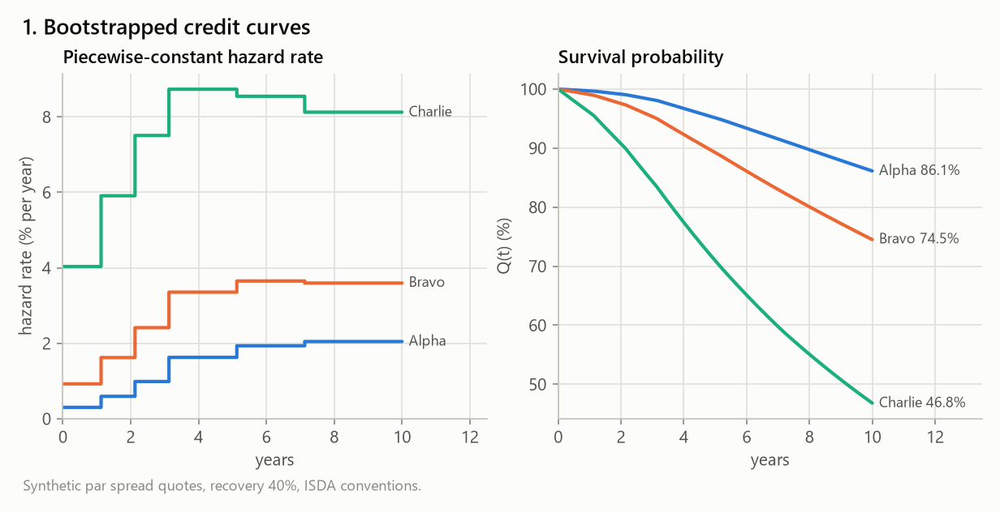
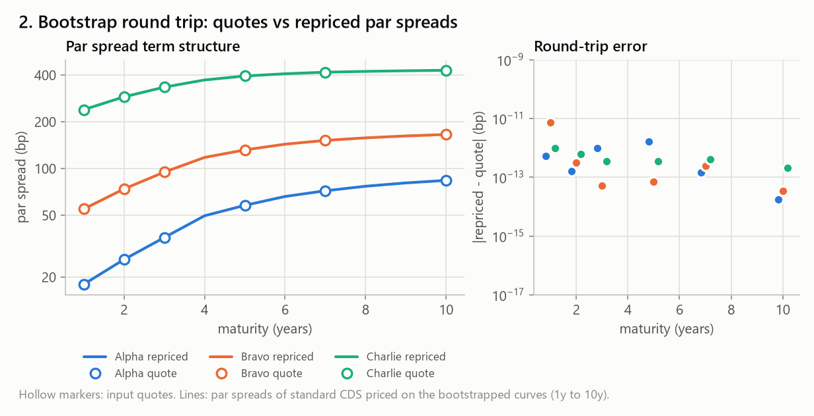
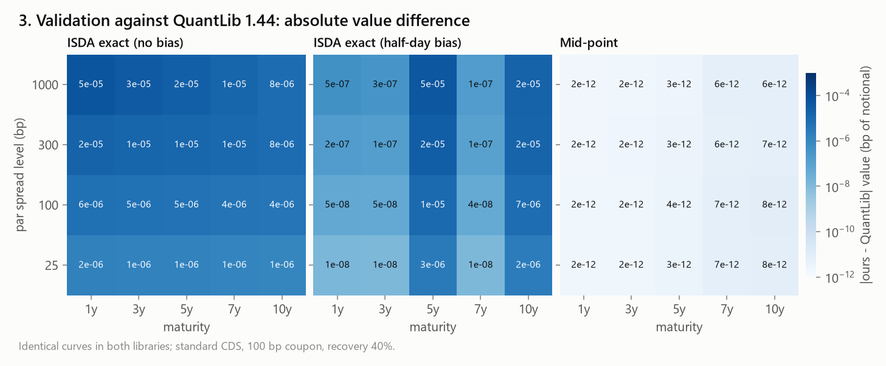
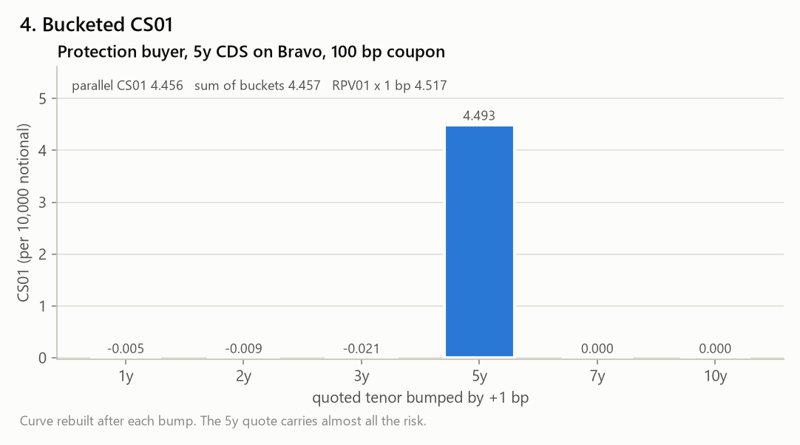
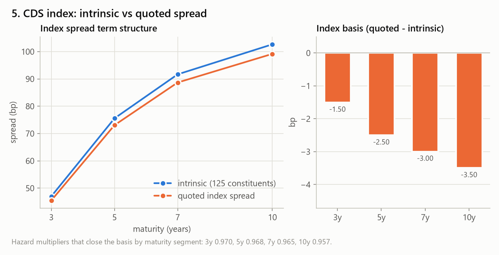
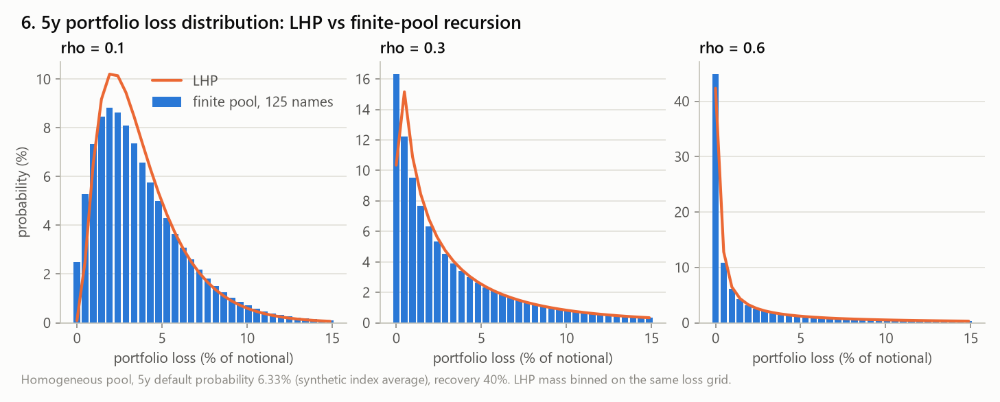
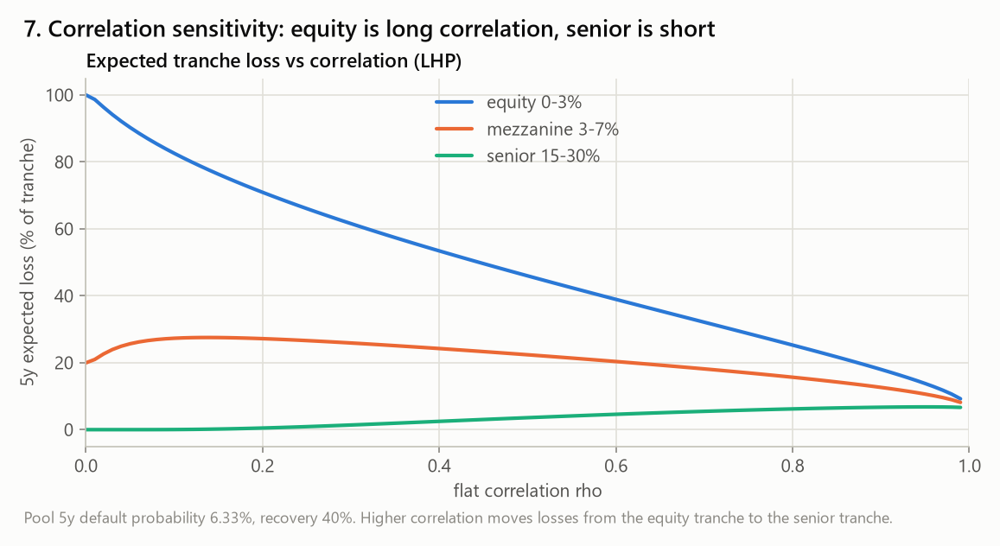
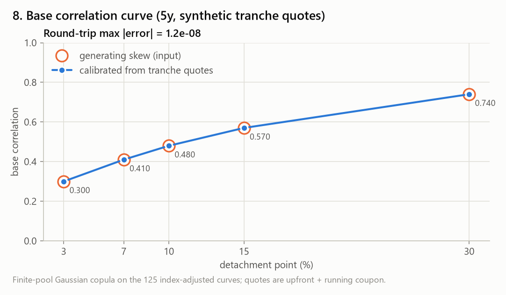
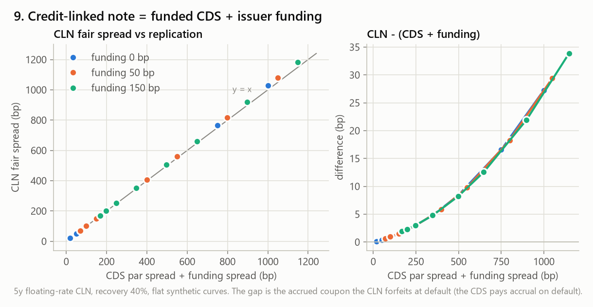

# credit-pricer

[](https://github.com/YoussefElb75/credit-pricer/actions/workflows/ci.yml)


A clean, typed and tested credit derivatives pricing library in Python, validated against
[QuantLib](https://www.quantlib.org/):

- **Curves**: discount curve bootstrapped from deposits and swaps; survival curve
  bootstrapped from CDS par spreads (piecewise-constant hazard rates, ISDA conventions).
- **Single-name CDS**: protection and premium legs, par spread, upfront, risky PV01,
  CS01 (parallel and bucketed) and recovery sensitivity, with three integration schemes
  that reproduce QuantLib's `IsdaCdsEngine` and `MidPointCdsEngine`.
- **CDS index**: intrinsic spread from constituents, index basis, and a hazard-rate
  adjustment that matches the quoted index.
- **Synthetic CDO tranches**: one-factor Gaussian copula with the large-homogeneous-pool
  formula and the exact finite-pool recursion; expected tranche loss, fair spread and
  upfront; base correlation calibration and the base correlation curve.
- **Credit-linked note**: funded CDS exposure plus issuer funding spread.

> **Data disclaimer.** No licensed or market data is used. Every input in [`data/`](data)
> is **synthetic and illustrative only**: it is generated deterministically by
> [`scripts/make_synthetic_data.py`](scripts/make_synthetic_data.py) and every file
> starts with a `# SYNTHETIC - illustrative only` header.

## Contents

- [Installation](#installation)
- [Quick start](#quick-start)
- [Package layout](#package-layout)
- [Conventions](#conventions)
- [Mathematics](#mathematics)
- [Validation against QuantLib](#validation-against-quantlib)
- [Figures](#figures)
- [Development](#development)
- [Limits of V1](#limits-of-v1)
- [License](#license)

## Installation

```bash
git clone https://github.com/YoussefElb75/credit-pricer.git
cd credit-pricer
python -m venv .venv
source .venv/bin/activate          # Windows: .venv\Scripts\activate
pip install -e ".[dev]"            # library + QuantLib, matplotlib, pytest, mypy, ruff
```

The library itself only depends on `numpy` and `scipy`; the synthetic data sets ship
inside the wheel. QuantLib is needed only for the validation
(`pip install -e ".[validation]"`) and matplotlib only for the figures
(`pip install -e ".[figures]"`).

## Quick start

```python
import datetime as dt
from credit_pricer import CDS, DiscountCurve, bootstrap_survival_curve, price_cds
from credit_pricer.cds import cs01

trade = dt.date(2026, 11, 5)
discount = DiscountCurve.flat(trade, 0.035)
tenors, spreads = [1, 3, 5, 7, 10], [0.0040, 0.0060, 0.0080, 0.0095, 0.0105]
survival = bootstrap_survival_curve(trade, discount, tenors, spreads, recovery=0.4)

cds = CDS.standard(trade, 5, coupon=0.01)        # 5y, 100 bp, maturity 20 Dec 2031
v = price_cds(cds, discount, survival)           # method="isda" by default
print(v.par_spread, v.upfront, v.rpv01)          # 0.0080, -0.00922, 4.609
print(cs01(cds, discount, tenors, spreads))      # 0.000465 per unit notional per +1 bp
```

The [demo notebook](notebooks/demo.ipynb) walks through every module on the synthetic
data and reproduces all the figures below.

## Package layout

```
src/credit_pricer/
├── dates.py               day counts, business days, IMM dates, CDS schedule
├── curves/
│   ├── discount.py        DiscountCurve, deposit/swap bootstrap
│   └── survival.py        SurvivalCurve, CDS par-spread bootstrap
├── cds/
│   ├── legs.py            protection / premium leg integration (isda, isda_halfday, midpoint)
│   ├── pricer.py          CDS, par spread, upfront, RPV01
│   └── risk.py            CS01 (parallel, bucketed), recovery sensitivity
├── index/cds_index.py     intrinsic spread, basis, hazard adjustment
├── tranches/
│   ├── copula.py          conditional default probabilities, factor quadrature
│   ├── loss.py            LHP closed form, finite-pool recursion
│   ├── tranche.py         tranche legs, fair spread, upfront
│   └── base_correlation.py  base correlation calibration
├── cln.py                 credit-linked note
├── data.py                loaders for the synthetic data sets
└── validation.py          comparison harness against QuantLib (optional dependency)
scripts/                   synthetic data, QuantLib validation table, figures
tests/                     pytest suite (130 tests)
notebooks/demo.ipynb       executed demo
docs/                      validation.md, figures/
```

## Conventions

| Item | Convention |
|---|---|
| Curve time | ACT/365F from the valuation (trade) date |
| Business days | Monday to Friday, no holiday calendar (QuantLib `WeekendsOnly`) |
| CDS coupon dates | 20 Mar / Jun / Sep / Dec, adjusted *following* |
| CDS maturity | unadjusted 20 Jun / 20 Dec, semi-annual roll (post-2015 `CDS2015` rule) |
| Accrual start | latest adjusted coupon date on or before the step-in date T+1 (ISDA) |
| Premium leg | quarterly, ACT/360; last period accrues through maturity inclusive |
| Step-in / cash settlement | T+1 calendar day / T+3 business days |
| Accrual on default | paid at default, accrued from the period start |
| Protection | from the start of the step-in day (end of T) to the end of maturity |
| Upfront | clean, paid by the protection buyer at cash settlement |
| Recovery | 40% unless stated |
| Index coupon | 100 bp; quoted spread converted with a flat hazard curve (ISDA) |
| Tranche quotes | upfront (% of tranche notional) + fixed running coupon |
| Discount curve | single-curve OIS-style: deposits ACT/360, annual ACT/360 par swaps |

All values are per unit notional, from the protection buyer's point of view.

## Mathematics

### Curves

The discount factor $`P(t)`$ is log-linear between nodes, i.e. the instantaneous forward
rate $`f(t)`$ is piecewise flat. Deposits fix $`P(T) = 1/(1 + r\,\tau)`$; each par swap
rate $`S_n`$ adds a node at its maturity, solved so that

```math
S_n \sum_{i=1}^{n} \tau_i\, P(t_i) = 1 - P(t_n).
```

The survival probability uses a piecewise-constant hazard rate $`h(t)`$:

```math
Q(t) = \exp\!\left(-\int_0^t h(u)\,du\right), \qquad h(t) = h_k \text{ on } (T_{k-1}, T_k].
```

Hazard rates are bootstrapped one maturity at a time (Brent's method): $`h_k`$ is the
value that makes a standard CDS with coupon equal to the quoted par spread $`s_k`$
worth zero.

### Single-name CDS

With recovery $`R`$, the protection leg and the risky annuity (RPV01) are

```math
\text{Prot} = (1-R)\int_{0}^{T} P(u)\,\bigl(-dQ(u)\bigr),
```

```math
\text{RPV01} = \sum_i \alpha_i\,P(t_i^{pay})\,Q(t_i)
 + \sum_i \int_{t_{i-1}}^{t_i} \frac{\alpha_i\,(u - t_{i-1})}{t_i - t_{i-1}}\,P(u)\,\bigl(-dQ(u)\bigr)
 - \alpha_{acc}\,P(t_{cs}),
```

where $`\alpha_i`$ is the ACT/360 accrual of period $`i`$, the second term is the accrual
paid on default and the last term removes the accrued premium $`\alpha_{acc}`$ rebated at
cash settlement $`t_{cs}`$ (clean RPV01). Then

```math
s_{par} = \frac{\text{Prot}}{\text{RPV01}}, \qquad
V = \text{Prot} - C\cdot\text{RPV01}, \qquad
U = \frac{V}{P(t_{cs})},
```

for a contract with coupon $`C`$, value $`V`$ at the trade date and clean upfront $`U`$ at
cash settlement.

**Exact integration (`isda`).** On every sub-interval $`[a, a+L]`$ where both $`h`$ and
$`f`$ are constant ($`k = h + f`$, $`B = P(a)\,Q(a)`$):

```math
\int_a^{a+L} P\,(-dQ) = \frac{h\,B}{k}\left(1 - e^{-kL}\right),
```

```math
\int_a^{a+L} (u - t_{i-1})\,P\,(-dQ) = h\,B\left[d_0\,\frac{1 - e^{-kL}}{k} + \frac{1 - e^{-kL}(1 + kL)}{k^2}\right],
```

with $`d_0 = a - t_{i-1}`$, Taylor-expanded when $`|kL| < 10^{-4}`$. `isda_halfday` adds
half a day to $`d_0`$: this is the accrual bias of the original ISDA Standard Model and
QuantLib's default. `midpoint` assumes default in the middle of each period with
QuantLib's `MidPointCdsEngine` date conventions.

**Risk.**

- CS01 is the value change for a +1 bp parallel shift of all quoted spreads, with the
  curve rebuilt. Bucketed CS01 bumps one quote at a time.
- Recovery sensitivity is reported two ways. *Rebuilt* re-bootstraps the curve at the
  new recovery, which is small for a near-par trade. *Fixed hazard* keeps the hazard
  rates, which gives $`-\text{Prot}/(1-R)`$ per unit of recovery.

### CDS index

For constituents with weights $`w_i`$, all priced at the index coupon $`C`$ and maturity:

```math
V^{intr} = \sum_i w_i\left(\text{Prot}_i - C\,\text{RPV01}_i\right), \qquad
s^{intr} = \frac{\sum_i w_i\,\text{Prot}_i}{\sum_i w_i\,\text{RPV01}_i}
 = \sum_i \frac{w_i\,\text{RPV01}_i}{\sum_j w_j\,\text{RPV01}_j}\; s_i .
```

The index basis is $`s^{quoted} - s^{intr}`$. The quote is turned into a value
$`V^{quoted}`$ with a flat hazard curve fitted to $`s^{quoted}`$ (market convention). The
adjustment multiplies every constituent's hazard rate on the maturity segment
$`(T_{k-1}, T_k]`$ by a common factor $`\alpha_k`$, solved in increasing maturity order so
that $`V^{intr}(\alpha_1,\dots,\alpha_k) = V^{quoted}_k`$.

It matches values (upfronts), so after the adjustment the intrinsic *spread* is close to,
but not exactly equal to, the quoted spread. The flat-curve conversion and the
heterogeneous constituent curves imply different RPV01s.

### Synthetic CDO tranches (one-factor Gaussian copula)

Name $`i`$ defaults before $`t`$ when $`\sqrt{\rho}\,Z + \sqrt{1-\rho}\,\varepsilon_i < \Phi^{-1}(p_i(t))`$,
so conditional on the factor

```math
p_i(t \mid z) = \Phi\!\left(\frac{\Phi^{-1}(p_i(t)) - \sqrt{\rho}\,z}{\sqrt{1-\rho}}\right).
```

**Large homogeneous pool.** As the number of names grows, $`L = (1-R)\,p(Z)`$. Its
distribution and the expected excess loss have closed forms; $`\Phi_2`$ is evaluated with
Owen's T function:

```math
\mathbb{P}(L \le x) = \Phi\!\left(\frac{\sqrt{1-\rho}\,\Phi^{-1}\!\left(\tfrac{x}{1-R}\right) - \Phi^{-1}(p)}{\sqrt{\rho}}\right),
```

```math
\mathbb{E}\left[(L-K)^+\right] = (1-R)\,\Phi_2\!\left(\Phi^{-1}(p),\, z^*;\, \sqrt{\rho}\right) - K\,\Phi(z^*),
\qquad z^* = \frac{\Phi^{-1}(p) - \sqrt{1-\rho}\,\Phi^{-1}\!\left(\tfrac{K}{1-R}\right)}{\sqrt{\rho}}.
```

**Finite pool.** For $`N`$ equally weighted names with heterogeneous $`p_i`$ and a common
recovery, the conditional distribution of the number of defaults is built name by name
(Andersen–Sidenius–Basu recursion):

```math
\pi^{(j)}_n(z) = \pi^{(j-1)}_n(z)\,\bigl(1 - p_j(z)\bigr) + \pi^{(j-1)}_{n-1}(z)\,p_j(z),
```

and integrated over $`Z`$ with composite Gauss–Legendre quadrature (192 nodes). This stays
accurate up to $`\rho = 0.99`$, where Gauss–Hermite with 64 nodes is off by ~10%. The
limits $`\rho = 0`$ (independent names) and $`\rho = 1`$ (comonotone names) are handled
exactly.

**Tranche legs.** For a tranche $`[A, D]`$ with expected loss
$`EL_j = \mathbb{E}\left[\min\left((L(t_j) - A)^+,\, D - A\right)\right]`$ on the premium dates:

```math
\text{Prot} = \sum_j P(\bar t_j)\,(EL_j - EL_{j-1}), \qquad
\text{RPV01} = \sum_j \alpha_j\,P(t_j)\left(D - A - \frac{EL_{j-1} + EL_j}{2}\right) - \alpha_{acc}\,P(t_{cs})\,(D - A),
```

where the last term rebates the premium accrued before step-in (clean convention, as for
single-name CDS). With zero recovery the $`[0, 100\%]`$ tranche reproduces the index
intrinsic spread (tested to 0.05 bp).

The fair spread is $`\text{Prot}/\text{RPV01}`$ and the upfront for coupon $`C`$ is
$`(\text{Prot} - C\,\text{RPV01})/(D-A)`$.

**Base correlation.** $`[A, D] = [0, D] - [0, A]`$, each base tranche priced at its own
flat correlation. Given contiguous quotes, $`\rho(K_1)`$ is solved from the equity
tranche, then each $`\rho(K_i)`$ from the next tranche, holding $`\rho(K_{i-1})`$ fixed.
The value of a base tranche is monotone in $`\rho`$, so each step has a unique root.

### Credit-linked note

The investor receives a floating coupon (the risk-free forward) plus a spread $`s`$ while
the reference survives, par at maturity, and recovery $`R`$ at default. Issuer risk
discounts with $`D_f(t) = P(t)\,e^{-f t}`$ for a funding spread $`f`$:

```math
\text{Price} = \sum_j \left(F_j\alpha_j + s\,\alpha_j\right) D_f(t_j)\,Q(t_j) + D_f(T)\,Q(T)
 + R\int_0^T D_f(u)\,\bigl(-dQ(u)\bigr).
```

The fair spread (price = par) is close to the CDS par spread plus the funding spread
(Figure 9).

## Validation against QuantLib

[`scripts/validate_quantlib.py`](scripts/validate_quantlib.py) writes the full tables to
[`docs/validation.md`](docs/validation.md). The test-suite asserts the same comparisons.

Grid: flat par spread curves at 25, 100, 300 and 1000 bp × maturities 1, 3, 5, 7 and
10y × three engines. Standard CDS with a 100 bp coupon, recovery 40%, QuantLib 1.44.

**Engine level.** Our curves are rebuilt node for node in QuantLib (`DiscountCurve`,
`HazardRateCurve`), and the same contract (`CDS2015` schedule from the step-in date,
`Actual360(true)` last period, accrual rebate) is priced by both libraries. "Value" is
the PV at the trade date for the protection buyer, i.e. QuantLib's `NPV()`; the quoted
upfront is this value forwarded to cash settlement.

| our method | QuantLib engine | cases | max abs diff par spread (bp) | max abs diff value (bp) | max abs diff RPV01 |
|---|---|---:|---:|---:|---:|
| `isda` | `IsdaCdsEngine` (NoBias, Taylor, Piecewise) | 20 | 5.0e-04 | 5.0e-05 | 5.0e-07 |
| `isda_halfday` | `IsdaCdsEngine` (HalfDayBias, Taylor, Piecewise) | 20 | 1.4e-04 | 4.6e-05 | 4.6e-07 |
| `midpoint` | `MidPointCdsEngine` | 20 | 2.0e-11 | 8.2e-12 | 8.2e-14 |

**Bootstrap level.** QuantLib bootstraps its own curve from the same quotes
(`SpreadCdsHelper` with the ISDA model + `PiecewiseFlatHazardRate`). Across the 20
cases, survival probabilities at the maturities agree to within 1.0e-07 and upfronts to
within 4.5e-04 bp.

Three things are worth stating explicitly:

1. **The half-day bias.** QuantLib's `SpreadCdsHelper` builds its engine with the default
   `HalfDayBias`, so we bootstrap with `isda_halfday` for this comparison. With the
   unbiased scheme the survival probabilities differ by up to 8e-05 at 1000 bp.
2. **Pillar placement.** QuantLib places hazard pillars one day after each maturity; ours
   sit at the maturity. The CDS never observes that day, so prices are unaffected.
3. **Residual on the exact schemes.** The protection legs agree to 1e-17. The accrual-on-
   default term differs by a constant relative ~5e-6, even on flat curves with zero
   rates. Both libraries use the same closed form; we have not isolated the source. The
   effect is at most 5e-4 bp of spread at 1000 bp, far below quoting precision.

The table above uses the trade date 2026-11-05. The test-suite repeats the engine
comparison on ten trade dates around coupon dates and weekends (for example the day
before a roll, when the step-in date is a coupon date), with the same tolerances.
Schedules (accrual start, coupon dates, maturity) are also checked date by date against
QuantLib's `CDS2015` schedule for every third trade date over 2025–2027.

## Figures

Generated by [`scripts/make_figures.py`](scripts/make_figures.py) from the synthetic
data. Each figure has a light and a dark version, and GitHub picks the one matching your
theme.

**1. Bootstrapped hazard rates and survival probabilities.** Hazard rates rise steeply over
the first five years of these upward-sloping spread curves and then flatten or dip. The
high-yield name survives 10 years with only ~47% probability.

<picture>
  <source media="(prefers-color-scheme: dark)" srcset="docs/figures/01_hazard_survival-dark.png">
  
</picture>

**2. Par spread term structure: quotes vs repriced.** The bootstrapped curves reprice
every input quote to better than 1e-11 bp. The lines show the par spreads they imply at
intermediate maturities.

<picture>
  <source media="(prefers-color-scheme: dark)" srcset="docs/figures/02_spread_round_trip-dark.png">
  
</picture>

**3. QuantLib validation.** Every case on the grid agrees with QuantLib to below 1e-4 bp of
notional. The mid-point engine matches to machine precision.

<picture>
  <source media="(prefers-color-scheme: dark)" srcset="docs/figures/03_quantlib_validation-dark.png">
  
</picture>

**4. CS01 by tenor bucket for a 5y CDS.** Nearly all the spread risk sits on the 5y quote.
Shorter buckets are slightly negative: raising them while the 5y quote stays fixed lowers
the later hazard segments.

<picture>
  <source media="(prefers-color-scheme: dark)" srcset="docs/figures/04_cs01_buckets-dark.png">
  
</picture>

**5. Index: intrinsic vs quoted spread and the basis.** The synthetic index trades 1.5 to
3.5 bp tight to its constituents. Hazard multipliers of 0.96–0.97 close the basis
segment by segment.

<picture>
  <source media="(prefers-color-scheme: dark)" srcset="docs/figures/05_index_basis-dark.png">
  
</picture>

**6. Portfolio loss distribution: LHP vs finite pool.** The LHP limit tracks the exact
125-name distribution closely. Higher correlation pushes mass towards zero loss and into
a fat right tail.

<picture>
  <source media="(prefers-color-scheme: dark)" srcset="docs/figures/06_loss_distribution-dark.png">
  
</picture>

**7. Tranche expected loss vs correlation.** Equity expected loss falls as correlation
rises (equity is long correlation), senior expected loss rises (senior is short), and
the mezzanine tranche is non-monotone.

<picture>
  <source media="(prefers-color-scheme: dark)" srcset="docs/figures/07_tranche_el_vs_correlation-dark.png">
  
</picture>

**8. Base correlation curve with round-trip check.** Calibrating to quotes generated from
a known skew recovers it to ~1e-8. The curve slopes upward, as in traded markets.

<picture>
  <source media="(prefers-color-scheme: dark)" srcset="docs/figures/08_base_correlation-dark.png">
  
</picture>

**9. CLN fair spread vs CDS spread + funding spread.** The note replicates as funded CDS
plus funding. The small gap grows with the spread because the CLN forfeits the accrued
coupon at default, whereas the CDS pays accrual on default.

<picture>
  <source media="(prefers-color-scheme: dark)" srcset="docs/figures/09_cln_spread-dark.png">
  
</picture>

## Development

```bash
python -m pytest                          # 130 tests (QuantLib/matplotlib tests skip if absent)
python -m mypy                            # strict
python -m ruff check .
python scripts/make_synthetic_data.py     # regenerate data/ (deterministic)
python scripts/validate_quantlib.py       # regenerate docs/validation.md
python scripts/make_figures.py            # regenerate docs/figures/
```

The tests cover:

- **Consistency:**
  - each bootstrap reprices its inputs;
  - value is linear in the coupon;
  - CS01 ≈ RPV01 × 1 bp, and the buckets sum to the parallel CS01;
  - tranche losses add up to the pool loss for any correlation;
  - the intrinsic spread equals the RPV01-weighted average;
  - a riskless floating-rate note prices at par.
- **Monotonicity:**
  - in hazard rate, maturity and spreads;
  - equity tranche loss falls and senior tranche loss rises with correlation.
- **Limit cases:**
  - zero hazard;
  - recovery 0% and 100%;
  - correlation 0 (binomial) and 1 (comonotone);
  - LHP vs a large finite pool;
  - closed forms on flat curves.
- **Cross-checks** against QuantLib and SciPy.
- **Figures:** `scripts/make_figures.py` runs end to end.

CI runs on GitHub Actions for Python 3.10, 3.12, 3.13 and 3.14 on Ubuntu, plus 3.14 on
Windows, and executes the demo notebook.

## Limits of V1

- **Calendars.** Weekends only, no holiday calendars. Valuation happens on the trade date
  only; there are no seasoned trades with a valuation date after the trade date.
- **Rates.** Deterministic, single-curve and OIS-style; no separate projection curve, no
  rate–credit correlation.
- **CDS.** Standard contracts only: non-IMM maturities are accepted but not validated;
  no restructuring clauses, no CDS options or index swaptions. Values are per unit
  notional.
- **Index.** Equal weights; no defaulted constituents or index factor; one hazard
  multiplier per maturity segment, shared by all names. Quote repricing is exact for the
  `isda` schemes. With `midpoint`, a maturity on a weekend leaves a residual of ~1e-9.
- **Tranches.**
  - Gaussian one-factor copula with deterministic recovery and equal notionals: no
    stochastic recovery, random factor loadings or other copulas.
  - No mapping of base correlations to bespoke portfolios.
  - Base correlation is not arbitrage-free in general; it can fail to calibrate to
    quotes outside the model's range.
  - No amortisation of the super-senior tranche by recoveries.
- **Credit-linked note.** Issuer risk is a deterministic funding spread (independent
  of the reference, with zero issuer recovery); coupons are lost at default.
- **Numerics.**
  - The finite-pool quadrature uses 192 nodes: E[p(Z)] is accurate to ~1e-5 relative
    at ρ = 0.99.
  - The base correlation search is bracketed in [1e-4, 0.995].
- **Data.** All synthetic; nothing here is market data or investment advice.

## License

[MIT](LICENSE) © 2026 YoussefElb75
